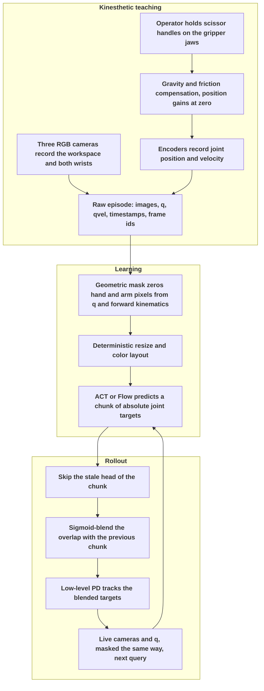
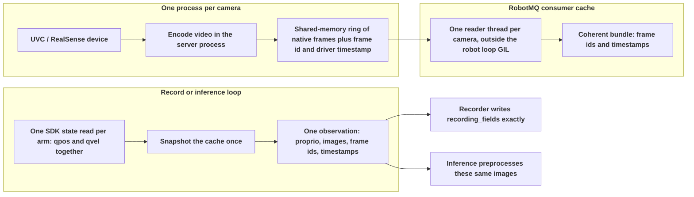
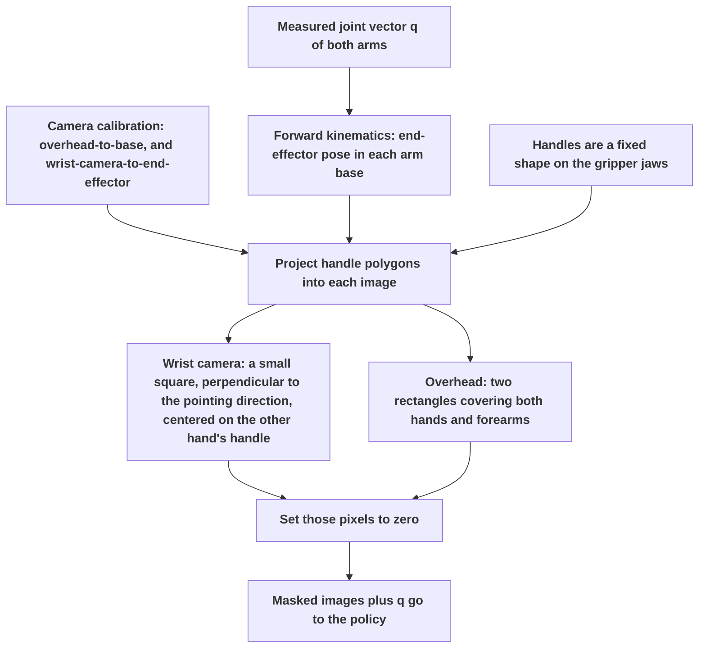
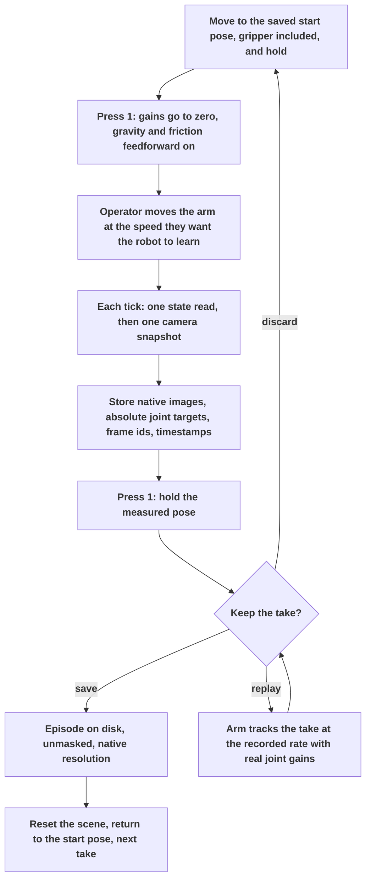
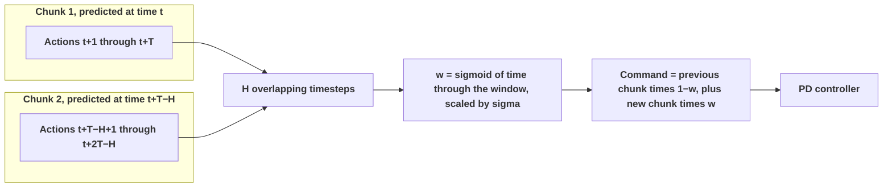
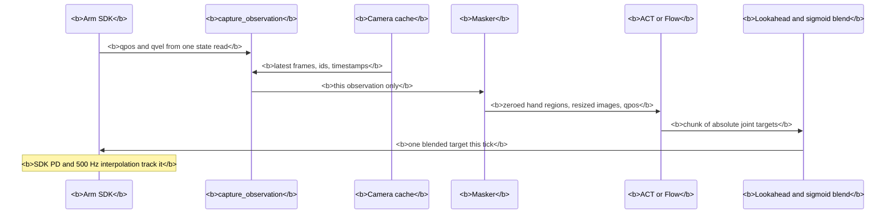

# **Flash ALOHA Architecture**

**This note explains the Flash ALOHA system: the research method in the paper, and the software architecture in this repository. It covers the cameras, the processing that removes the operator’s hands from the policy’s view, and the optimizations that keep recording and rollout fast and smooth.**

**Paper. Flash ALOHA: Learning Fast and Precise Manipulation, John Hua Yao, Qi Wu, Yihuai Gao, Chelsea Finn, and Zipeng Fu, Stanford University. First presented as ALOHA Lightning at ICRA (Vienna, July 2026).**

| | |
| --- | --- |
| **Project site** | **https://johnyao93.github.io/flash-aloha/** |
| **Paper PDF** | **https://johnyao93.github.io/static/files/flash-aloha.pdf** |
| **arXiv (ALOHA Lightning title)** | **https://arxiv.org/abs/2611.21919** |
| **This repository** | **the collection, training, and deployment stack for that method on ARX arms** |

**The paper is the method. This repository is the engineered pipeline that records demonstrations, trains ACT and Flow policies, and rolls them out on the robot, with strict contracts so collection, training, and inference see the same observations.**

---

## **1. What the paper set out to fix**

**Learned manipulation policies usually move much slower than a person. The paper names two causes.**

1. **The data is slow. Leader-follower puppeteering, VR controllers, and 3D mice add latency and give the operator weak haptic feedback. People slow down to stay accurate. The policy then imitates those slow trajectories. Speeding a slow dataset up at deployment (run the controller twice as fast, or skip every other action) drops success sharply, and toss-and-catch cannot be collected that way at all.**
2. **Fast data is hard to execute. Action chunking predicts a block of future joint targets, then jumps to the next block. At high speed those jumps become visible jerks. The operator’s hands are also in the cameras during teaching and absent at deployment, so the pictures the policy saw in training do not match the pictures it sees alone.**

**Flash ALOHA answers both with one stack:**

- **Collect near-human-speed demonstrations by kinesthetic teaching: the operator holds handles on the gripper and backdrives a light, low-friction arm under gravity compensation. Joint encoders record the true pose. Visual-inertial trackers drift by more than 10 cm on the same fast motions, so the paper does not use them as the action source.**
- **Train an action-chunking policy (ACT in the paper) on absolute future joint positions.**
- **Mask the operator out of every camera with a geometric model, at training and again at every deployment frame, so both phases see hands as blacked-out regions.**
- **Smooth the chunk boundary at test time with a short sigmoid blend, and skip the stale start of each new chunk (action lookahead) so the arm does not step backward while the network was computing.**

**With 50 demonstrations per task, the paper reports above 80% success on bimanual ball toss-and-catch, folding shorts, battery insertion, bussing a table, and unstacking cups, at close to human speed. Toss and catch finishes in 1.85 s. Folding shorts finishes in about 6 s. Bussing a place setting finishes in under 7 s.**

---

## **2. End-to-end architecture**

**Three clocks stay distinct. The camera exposes frames on its own clock. The recorder / policy loop samples state and grabs the latest valid frames together. The arm controller (500 Hz inside the ARX SDK in this repository) interpolates each joint target. The paper’s low-level tracker is a PD controller on the commanded joint positions. Query rate, chunk length, and controller rate are different numbers and must be checked against each other.**

---

## **3. Hardware in the paper**

**The platform is bimanual: two 6-DoF arms, each with a parallel-jaw gripper.**

| **Piece** | **Role** |
| --- | --- |
| **ARX arms** | **Default platform. Planetary gears, so a person can backdrive the joints. Used for cups, battery, bus-table, and folding.** |
| **HESSIAN arms** | **Used only for toss-and-catch, which needs higher joint speed and still lower friction.** |
| **Scissor handles** | **One handle on each gripper jaw. Small handle for the thumb, long handle for the other four fingers, held with a strap. Pull down and sideways on the handles. Push up by contact under the arm.** |
| **Gravity compensation** | **Torque from link masses and joint positions, updated at 100 Hz, so the arm floats where the operator leaves it.** |
| **Friction compensation** | **Optional feedforward on joints and gripper, on only while the person is moving the arm.** |
| **Gripper** | **The same jaws the person holds are the jaws that grasp. Opening and closing is part of the demonstrated action.** |

**Comfort is a data-quality choice. A heavy or sticky arm forces slow demos. A floating arm lets a new operator, after a few minutes, collect battery insertion much faster than on a leader-follower ALOHA.**

**Between episodes the operator can replay the take on the real arm. That catches trajectories the position controller cannot track before they enter the dataset. There is no separate leader robot, so there is no leader-to-follower latency and no second embodiment to retarget.**

**This repository drives ARX L5 and Trossen L5 arms over CAN (**`robot.type: arx` **in the task YAML), as well as PiperX arms (**`robot.type: piperx`**). The paper’s HESSIAN toss-and-catch rig is not what the example** `single_arm` **and** `bimanual` **tasks start. Gravity is tuned once per physical ARX arm with** `scripts/tune.py gravity`**, then friction with** `scripts/tune.py friction`**, and the SDK stores the result in the URDF.**

---

## **4. How the cameras work**

### **4.1 What the paper records**

**Three RGB cameras, all at 50 Hz:**

| **Camera** | **Mount** | **What it sees** |
| --- | --- | --- |
| **Top / overhead** | **Above the table, looking down** | **Both arms, both hands, and the workspace** |
| **Left wrist** | **On the left arm, aimed between the gripper jaws** | **The grasp, and often the other hand** |
| **Right wrist** | **On the right arm, aimed between the gripper jaws** | **The grasp, and often the other hand** |

**Each frame is stored at 360 × 640. The policy does not eat that resolution. Training downsamples to 180 × 320, then applies a random crop covering 95% of each side and resizes that crop back to 180 × 320. The crop is training-only augmentation. Joint positions** `q` **and joint velocities** `q̇` **are logged at the same 50 Hz. The policy is conditioned on images and joint positions only. Velocities are recorded and are not a policy input. Toss-and-catch is the exception on rate: the tossing arm is logged at 100 Hz and the catching arm at 200 Hz.**

**The wrist cameras exist so the policy can see contact between the jaws. The overhead camera exists so it can see the table layout. Hands occupy both views during teaching.**

### **4.2 What this repository does with cameras**

**Recordings stay at the camera’s native pixels. Nothing in collection bakes a resize, a color conversion, or a hand mask into the video. Training and inference apply the shared preprocessor in** `src/contracts/standard_image_processing.py` **to those pixels. Example tasks (**`single_arm`**,** `bimanual`**) declare a 100 Hz action rate, which is faster than the paper’s 50 Hz table tasks.** `single_arm` **uses** `video_overhead` **and** `video_left`**.** `bimanual` **adds** `video_right`**.**

**The capture rule is the whole camera contract:**

1. **Read proprioception once per arm, from a single SDK state result. Position and velocity come from that same result.**
2. **Then snapshot the shared camera cache once.**
3. **Recording stores that observation’s** `recording_fields()` **(pixels by frame id, plus driver and consumer timestamps).**
4. **Inference runs the policy on the images inside that same observation.**
5. **Nothing rereads the cameras or the joints to fill the other half, and nothing picks a “nearby” frame after the fact.**

**Missing, stale, or skewed frames fail the sample. A raw video that does not contain a referenced frame fails export. The raw data is kept for diagnosis. Python garbage collection is paused for the whole capture process (**`src/contracts/capture_gc.py`**) so a collection pause cannot land between the joint read and the image snapshot.**

**Each camera server holds a CPU wake-up latency limit (20 µs) while it streams. At 100 fps a deep CPU idle state can wake too slowly, the USB driver drops a burst of frames, and recording fails closed on a stale frame. Exposure, gain, and white balance are tuned and saved (**`scripts/cameras/tune_cameras.py`**). Auto exposure-framerate is turned off so the frame period stays stable. The saved controls are copied into episode metadata and checked again at inference: a checkpoint trained at one exposure is refused if the live camera file disagrees.**

**Eight shared-memory slots per camera bound image memory (on the order of 70 MiB of rings for three 1280×800 BGR frames). The robot thread never waits on USB. It reads the latest coherent bundle the cache has already assembled.**

---

## **5. Removing the human hand**

**The hands are not erased from the recording. They are erased from the policy input, with the same function in training and at rollout. The paper’s name for that function is** `M`**.**

**At time** `t`**, with images** `I1, I2, I3` **and joint position** `q_t`**:**

`I'1, I'2, I'3 = M(I1, I2, I3, q_t, FK)`

`FK` **is forward kinematics from the robot URDF. Masked pixels are set to RGB zero. The region moves every frame because it is attached to the measured joints.**

### **5.1 Why a geometric mask, and why not inpainting**

**During teaching, fingers and forearms cover the end effector and cast shadows on the table. At rollout the hands are gone. A policy can latch onto “a hand is here” and then stall when the hand disappears, or it can ignore the objects the hand was covering.**

**The paper compares three training views:**

| **Method** | **What the policy sees** | **Result** |
| --- | --- | --- |
| **No mask** | **Raw frames, hands included** | **Strong, but worse on battery insertion (75% whole-task) and folding (90%).** |
| **Diffusion inpainting** | **SAM 2 segments the person. ProPainter fills the hole with background.** | **Worse than raw video. Shadows stay on the table. The fill is noisy because the model lacks context. Those artifacts are absent at test time, so they become a new domain gap.** |
| **Analytic mask (theirs)** | **Black polygons locked to the end-effector pose** | **Best or tied on every task. Battery insertion rises to 85%. Folding shorts rises to 100%.** |

**Zeroing a polygon is deterministic. The same joints produce the same silhouette in training and on the robot. Inpainting is a second learned model, and it does not see the test-time scene.**

**The mask is deliberately a bit large. The paper notes that it also deletes some useful pixels next to the hands (the object edge, a bit of the gripper). That cost is accepted because the train/test pictures then match.**

### **5.2 Geometry used in the paper**

**Details from the paper:**

- **Both arms’ end-effector poses are known in their own base frames from FK.**
- **A calibrated transform relates the two base frames, so one arm’s hand can be drawn into the other arm’s wrist camera.**
- **The handles do not move relative to the gripper, so the hand center is a fixed offset from the end effector.**
- **In the right wrist camera, a small square covers the left hand, perpendicular to the end-effector pointing axis, near the handles. The left wrist camera covers the right hand the same way.**
- **In the top camera, two rectangles follow both hands and both forearms.**
- **Deployment runs** `M` **on every live frame. Training runs** `M` **on the stored frames. The network never receives an unmasked hand as its input.**

### **5.3 Geometry used in this repository**

`src/utils/masking.py` **(**`Masker`**) implements the same idea as data, not as a hard-coded square. Strategies live in** `calibration/masking/masking.yaml`**. A training recipe selects one with** `data.masking_strategy`**. The checkpoint stores the strategy and a digest of the calibration. Direct inference rebuilds that contract and refuses to run if the YAML or the calibration files changed. Recordings on disk stay unmasked, so a different strategy can be tried by retraining, without recapturing.**

**The shipped** `end_effector` **strategy is the paper’s mask, expressed as polygons in metres:**

| **View** | **Polygon** |
| --- | --- |
| **Overhead** | **A rectangle that follows each arm’s wrist.** |
| **Wrist camera** | **A rectangle that follows the other arm’s end effector.** |

**Other strategies blank a whole camera, zero a fixed image fraction, or zero proprioception. Projected masks need a real calibration, in this order:**

1. **Intrinsics per camera (**`scripts/cameras/camera_int.py`**): camera matrix and distortion at a declared image size.**
2. **Wrist-camera extrinsics (**`scripts/setup/calibrate_masking.py wrist-camera`**): the camera pose in the end-effector frame, from checkerboard views while the arm is passive.**
3. **Overhead extrinsics (**`scripts/setup/calibrate_masking.py overhead`**): the arm base in the overhead camera frame.**

**Projection, in the calibration note:**

- **A point in the arm base frame lands on overhead pixels by** `K_overhead` **times** `T_overhead_base` **times** `p`**.**
- **The same point lands on the wrist image by** `K_wrist` **times the inverse of** `T_base_ee` **times** `T_ee_camera`**, times** `p`**.**
- `T_base_ee` **is FK of the joints for that observation. Lens distortion is not applied to the mask.**
- **Intrinsics are rescaled from the calibrated resolution to whatever image is being masked, so the same polygons work at any policy size.**

**Order on the pixels: resize first, then mask, then channel order and float scaling. The mask uses the qpos of the same observation.** `scripts/setup/tune_masking.py` **can drag the polygons on a saved episode or on a live arm.** `scripts/visualize.py episode` **draws the mask at policy resolution from each frame’s recorded qpos so a bad calibration is visible before training.**

**Direct inference applies the mask. The websocket model server and the remote client do not, and they refuse a masked checkpoint. Masked policies stay on the direct path.**

---

## **6. What is optimized while recording the dataset**

**The dataset optimization is “make the demonstrated motion already fast, accurate, and replayable.” The policy is not asked to invent speed later.**

### **6.1 In the paper**

| **Choice**                                                  | **Why it makes the motion fast and clean**                                                                                                               |
| ----------------------------------------------------------- | -------------------------------------------------------------------------------------------------------------------------------------------------------- |
| **Backdrivable planetary actuators**                        | **Low joint friction compared with harmonic drives. The operator can accelerate the arm instead of fighting the gearbox.**                               |
| **Gravity compensation at 100 Hz**                          | **The arm feels closer to weightless, so long takes do not droop and fatigue does not slow the person down.**                                            |
| **Friction feedforward, optional**                          | **Removes the sticky breakaway at direction changes.**                                                                                                   |
| **Handles on the real gripper**                             | **Vision, contact force, and sound arrive with no teleoperation delay. Grasp force is demonstrated on the same mechanism that will execute it.**         |
| **Encoder** `q` **and** `q̇` **as the action source**       | **Pose error stays small as speed rises. A wrist visual-inertial tracker on the same motions drifts past 10 cm and drops tracking above roughly 1 m/s.** |
| **50 Hz images and state (100 / 200 Hz on toss-and-catch)** | **The log matches the speed of the task instead of undersampling a swing.**                                                                              |
| **Absolute future joint positions as labels**               | **The low-level PD is asked to reach the pose the person actually achieved, on time.**                                                                   |
| **Replay between episodes**                                 | **If the controller cannot follow the recorded positions, the take is fixed or thrown out before training.**                                             |
| **Short timed tasks**                                       | **Cups in 4 s, folding in 5 s, bus table in 6 s, battery under 7 s, toss-and-catch in 2 s. The timer keeps demonstrations in the fast regime.**          |
| **50 demonstrations, randomized along a tape mark**         | **Enough for ACT to generalize a few centimetres of object shift without slowing the motion down to “be safe.”**                                         |

**A user study in the paper (7 people, little teleoperation experience, battery insertion) found operators became fluent on this hardware and finished the task more than 50% faster than on puppeteering, up to about 3× for some people. They sit at the table and feel the real arm.**

### **6.2 In this repository**

**Hand-guided collection (**`docs/hand_guided_recording.md`**) follows that pattern.**

- **Start pose. Every take begins at** `calibration/start_positions/<task>.npz`**, including the gripper opening, unless** `--guided-start` **or** `--no-start-position` **is set. Inference moves to the same pose before a rollout, so the first frame matches the dataset.**
- **Passive while demonstrating. Position and damping gains are zero. Gravity compensation stays on. Friction feedforward is on only while the operator is moving the arm or the gripper by hand, and off while the arm holds, homes, or replays.**
- **Absolute actions only. Recorded targets are SDK joint radians and gripper width in metres. Relative-action training is rejected by** `action_contract`**.**
- **Native video. Encoding runs in the camera server. The control loop stores frame ids, not a second copy of the pixels and not a resized preview. Masks and letterboxing happen later.**
- **One rate. The task YAML declares** `control_freq` **(100 Hz on the example tasks). Episodes store that rate. Training and inference refuse a checkpoint whose rate does not match.**
- **No gaps inside a training sequence. A dropped stretch of frames ends a sequence. The loader will not build a chunk that steps across a hole (**`sequence_contract`**).**
- **Review replay. Before saving,** `r` **plays the take on the arm at the recorded rate with the session’s joint gains. That is the paper’s “catch tracking failures at collection time,” built into the recorder keys.**
- **Fail closed. Stale camera frames, skewed cameras, or a late joint read abort the sample. The pipeline does not invent a timestamp from the nominal FPS and does not substitute a newer frame.**
- **Steady capture thread. Automatic garbage collection stays off for the life of the capture process. Idle collection is allowed only between episodes.**

**Collection leaves trajectory smoothing, hand inpainting, and network-resolution downsampling to training and rollout. Keeping the raw episode intact is what makes the later checks possible.**

---

## **7. Policy learning**

**The paper trains ACT (Action Chunking with Transformers): a ResNet-18 backbone on each camera, no CVAE encoder, hidden size 512, feedforward size 3200, 4 encoder layers, 7 decoder layers, 8 heads, chunk length 50 (1 second at 50 Hz). Optimizer is AdamW, learning rate** `2 × 10⁻⁴`**, weight decay** `10⁻⁴`**, batch 256, 200k steps. Targets are absolute joint positions and gripper commands for the next** `T` **steps:**

`π(q_{t+1} … q_{t+T} | I'1, I'2, I'3, q_t)`

**The chunk is the fix for compounding error. A one-step policy that is slightly wrong at high speed is immediately outside the data. A chunk commits to a short horizon of the demonstrated motion and only then re-observes.**

**This repository keeps that ACT setup and adds a second policy, Flow (a LeRobot U-Net / visual backbone). Example ACT recipes use chunk length 100, which is 1 second at the 100 Hz task rate, batch 128, and 100k steps. Both policies can be trained with a real-time-chunking (RTC) prefix: the model learns to continue a committed head of actions instead of inventing a new plan from index zero. ImageNet normalization stays inside the network. Color and crop augmentation stay in the training loader, after the shared deterministic resize, and are off at deployment.**

**A checkpoint directory holds** `all_configs.json`**,** `dataset_stats.pkl`**, and the weights. The JSON freezes the task rate, camera list, robot contract, image-preprocessing profile, mask contract, and chunk length. Inference loads that file and will not let an inference YAML override them.**

---

## **8. What is optimized at inference and rollout**

**High-speed failure is mostly at the chunk boundary. The arm is tracking chunk 1. The network emits chunk 2 from a slightly older image, and the first target of chunk 2 does not sit on the last target of chunk 1. At low speed the jump is a few millimetres and the PD soaks it up. At the speeds in this dataset the jump excites the arm, grasps miss, and pushes glance off.**

**The paper uses two test-time fixes. This repository implements both, and adds a third (RTC) for when the network is trained to expect a prefix.**

### **8.1 Action lookahead: do not play the stale head**

**A chunk’s first action is the action for the moment the image was taken. By the time the forward pass finishes and the arm has caught its previous target, that moment is in the past. Playing action 0 pulls the arm backward.**

**The paper tunes a skip of the first** `n` **actions at every chunk boundary after the first. This repository exposes that as** `--action_lookahead` **(default 10) and a separate** `--gripper_lookahead` **(default 5) that reads the gripper a little further ahead, because the jaws should arrive at the close command as the arm arrives at the object. At 100 Hz, 10 steps is 100 ms and 5 more gripper steps is 150 ms.**

**The first chunk of a rollout has no previous boundary, so it starts at action 0. Only the gripper offset applies to it. If the new plan is still behind the arm at the boundary, raise the lookahead. If the arm lurches ahead, lower it. These two knobs apply to direct inference without RTC.**

### **8.2 Sigmoid blending: crossfade the overlap**

**Notation from the paper. Chunk length is** `T`**. Smoothing window is** `H`**, with** `H < T`**.**

- **At time** `t` **the policy emits chunk 1: targets** `q̂¹` **for steps** `t+1 … t+T`**.**
- **The next query is issued early, at** `t + T − H`**, so the two chunks share** `H` **timesteps. Chunk 2 is** `q̂²`**.**
- **Outside the overlap, the command is the raw target from whichever chunk owns that time.**
- **Inside the overlap, at time** `t'`**:**

`w(t') = sigmoid( (t' − (t + T − H) − H/2) / σ )`

`a(t') = (1 − w) · q̂¹(t'+1) + w · q̂²(t'+1)`

`σ` **sets how sharp the handoff is. A small** `σ` **snaps over to the new chunk. A larger** `σ` **lingers on the old plan.** `H` **sets how long both plans are mixed.**

**This is post-hoc. The network weights do not change. Only the command sent to the PD changes.**

**Why not temporal ensembling. ACT’s older smoother predicts a new chunk every timestep and exponentially averages the overlapping predictions. The paper finds that this halves execution speed, because the robot waits on a forward pass at every tick. It also averages across a change of plan: when tracking error forces a correction, the average splits the difference and the arm floats between two strategies. At high speed that shows up as hovering over the battery instead of pushing it in. Sigmoid blending keeps a single committed chunk and only crossfades at the boundary, so the task stays at collection speed (about 4–7 s) instead of stretching to 8–12 s.**

**Measured in the paper (whole-task success, smoothed vs not):**

| **Task** | **No smoothing** | **Temporal ensembling** | **Sigmoid smoothing** |
| --- | --- | --- | --- |
| **Unstack cups** | **65% in 4.23 s** | **35% in 7.75 s** | **90% in 3.97 s** |
| **Battery insertion** | **75% in 5.29 s** | **55% in 10.18 s** | **85% in 5.70 s** |
| **Bus table** | **80% in 6.70 s** | **100% in 12.23 s** | **100% in 6.81 s** |
| **Fold shorts** | **80% in 6.16 s** | **90% in 11.60 s** | **100% in 5.94 s** |

**Bus table is the case where averaging can raise success and still costs half the speed. The paper keeps the fast smoother.**

**This repository’s direct profiles set** `blending.method: sigmoid` **and** `blending.steps: 5`**. Linear and exponential blends exist. The blend starts at the lookahead index, and it is not shortened by the lookahead. The profile is rejected before the arm moves unless the chunk horizon covers chunk steps + lookahead + gripper offset + blend tail. Example shape: chunk size 100, execute 50 steps, lookahead 10, gripper offset 5, blend 5.**

### **8.3 Real-time chunking, the extra option in this repository**

**RTC is the paper’s “query early” idea, trained into the network (Black, Galliker, and Levine). The next chunk is conditioned on the actions the robot has already committed to. While the query runs, the arm keeps executing that prefix. When the new chunk arrives it continues from the prefix instead of from a jumped start.**

|                         | **Direct, no RTC**                                                         | **Direct with RTC**                                                           | **Remote RTC**                                                                                                  |
| ----------------------- | -------------------------------------------------------------------------- | ----------------------------------------------------------------------------- | --------------------------------------------------------------------------------------------------------------- |
| **When the query runs** | **At the chunk boundary, robot waits or uses lookahead to hide the delay** | **A prefix-length before the boundary, in a background worker**               | **Same asynchronous handoff, overlap fixed in the inference YAML**                                              |
| **How chunks join**     | **Lookahead skip + sigmoid blend**                                         | **Pinned prefix, then a crossfade on the new chunk’s side only**              | **New chunk starts at** `overlap_steps`**. Measured delay must fit in that budget or the rollout fails closed** |
| **Blend**               | `blending.steps` **across the boundary**                                   | **Crossfade after the prefix. The prefix itself is the unblended prediction** | **Remote profiles require** `blending.method: none`                                                             |
| **Lookahead flags**     | `--action_lookahead`**,** `--gripper_lookahead`                            | **Rejected. No planned action is skipped**                                    | **Rejected. The overlap is the skip**                                                                           |

**A late RTC response is not patched. The rollout stops closed rather than playing a discontinuous chunk. Training must have been run with** `training.training_time_rtc: true` **or inference will not enable it. The prefix length defaults to 10 actions.**

### **8.4 Other rollout details that keep the motion smooth**

| **Mechanism**                                           | **Where**                               | **Effect**                                                                                                                                                          |
| ------------------------------------------------------- | --------------------------------------- | ------------------------------------------------------------------------------------------------------------------------------------------------------------------- |
| **Same mask** `M` **on the live frame**                 | **Direct inference, every observation** | **The network sees black polygons where the hands were, matching training.**                                                                                        |
| **Same resize and color profile**                       | `standard_image_processing`             | **A checkpoint cannot be fed a differently cropped image. OpenPI is a separate profile: the client letterboxes to 448×448 and the server refuses any other shape.** |
| **Saved start pose, including gripper**                 | **Before the first chunk**              | **Rollout frame 0 matches take frame 0.**                                                                                                                           |
| **SDK interpolation at 500 Hz**                         | **ARX backend**                         | **The policy can emit targets at 50 or 100 Hz. The motor loop fills the gaps.**                                                                                     |
| `fast_inference`                                        | **Direct ACT / Flow**                   | **CUDA graphs the batch-1 forward. On a laptop 3070 Ti a Flow query drops from about 70 ms to about 17 ms. Actions move by about** `5 × 10⁻⁴` **rad versus fp32.**  |
| **Command watchdog**                                    | **Shared hardware runtime**             | **If targets stop arriving (default 1 s) the arms damp and hold the gripper. A human homes them. The policy cannot coast on a stale chunk.**                        |
| **Stale-frame rejection**                               | `capture_observation`                   | **A late camera does not get paired with a new joint reading. The loop fails instead of acting on a mismatched picture.**                                           |
| **Garbage-collection pause**                            | **Capture process**                     | **A multi-millisecond GC pause cannot land inside a 10 ms control tick.**                                                                                           |
| **Absolute targets, no clamping into a relative delta** | **Action contract**                     | **The PD receives the same coordinate system the demonstrator recorded.**                                                                                           |

**DAgger (a human takes the arm during a rollout and the correction is recorded) exists in the direct runner. It uses the same capture path. It is rejected on the shared-hardware remote path.**

---

## **9. How a rollout tick fits together**

**With RTC, the diagram splits. The arm keeps consuming the previous chunk’s prefix while** `Pol` **runs.** `Blend` **only crossfades once the new chunk is ready and the prefix has been executed. A query that is still running at the boundary aborts the rollout.**

---

## **10. Repository map**

| **Path**                                     | **Owns**                                                                                          |
| -------------------------------------------- | ------------------------------------------------------------------------------------------------- |
| `src/config/tasks/`                          | **Arms, CAN interfaces, camera names and order,** `control_freq`**, state and action size**       |
| `src/config/training/`                       | **ACT or Flow, chunk length, optimizer, masking strategy, training-time RTC**                     |
| `src/config/inference/`                      | **How many chunk steps to execute, blend, runtime RTC, direct vs remote**                         |
| `src/contracts/standard_capture.py`          | **One proprio read, then one camera snapshot**                                                    |
| `src/contracts/capture_gc.py`                | **No automatic GC during capture or streaming**                                                   |
| `src/contracts/standard_recording.py`        | **Start streams before the first sample, drain on every exit, store the observation as captured** |
| `src/contracts/standard_image_processing.py` | **The only resize / color / layout path**                                                         |
| `src/camera_utils/`                          | **Camera servers, shared-memory cache, clocks**                                                   |
| `src/utils/masking.py`                       | **Project polygons and zero pixels and, if asked, proprioception**                                |
| `calibration/masking/`                       | **The physical setup’s intrinsics, extrinsics, and strategy polygons**                            |
| `src/recording/`                             | **Hand-guided collection, episode buffer, review replay**                                         |
| `src/policy/`                                | **ACT and Flow, including training-time RTC**                                                     |
| `src/inference/`                             | **Direct runner, remote client, websocket server**                                                |
| `src/hardware/`                              | **ARX SDK backend, gains, homing, damping**                                                       |

**Config flows one way. The task names the hardware. The training recipe names the task. The inference profile names the task and a checkpoint. Each later stage checks the metadata the earlier stage wrote. An inference profile cannot silently change the camera list, the rate, or the mask.**

---

## **11. Results worth remembering from the paper**

**All figures are from the project PDF, 50 demonstrations per task.**

**Masking (their mask vs raw vs inpainting), whole-task success:**

| **Task** | **No mask** | **Inpainting** | **Analytic mask** | **Time with mask** |
| --- | --- | --- | --- | --- |
| **Unstack cups** | **90%** | **85%** | **90%** | **3.97 s** |
| **Battery insertion** | **75%** | **65%** | **85%** | **5.70 s** |
| **Bus table** | **100%** | **100%** | **100%** | **6.81 s** |
| **Fold shorts** | **90%** | **80%** | **100%** | **5.94 s** |

**Speed against an ALOHA 2 leader-follower baseline, whole-task success:**

| **Task** | **Puppeteering** | **Double controller rate** | **Skip every other action** | **Flash ALOHA** |
| --- | --- | --- | --- | --- |
| **Unstack cups** | **75% in 8.84 s** | **65% in 5.47 s** | **50% in 5.58 s** | **90% in 3.97 s** |
| **Battery insertion** | **55% in 17.87 s** | **15% in 12.90 s** | **30% in 10.30 s** | **85% in 5.70 s** |
| **Bus table** | **90% in 16.05 s** | **85% in 9.30 s** | **85% in 9.29 s** | **100% in 6.81 s** |
| **Toss and catch** | **not collected** | **not collected** | **not collected** | **80% in 1.85 s** |

**Doubling the controller rate on slow puppeteered data makes chunk-boundary jumps about 3 to 3.5 times larger. Skipping actions avoids some of that jump and instead skips contact events (the battery push, the cup lip). The paper’s claim is that the speed has to be in the demonstration. Playback tricks do not recover it.**

**The authors’ own limits, from the conclusion: the mask is conservative and deletes scene detail next to the hands, and the policy sees only vision and proprioception, so contact-rich dexterity (feeling the spring in the battery bay) is still mostly inferred from pictures.**

---

## **12. Reading order**

| **Question**                                       | **Read**                                                            |
| -------------------------------------------------- | ------------------------------------------------------------------- |
| **The method, the ablations, the hardware photos** | **The paper PDF linked above**                                      |
| **Bring up an arm**                                | `docs/arm_bringup.md`                                               |
| **Record a take**                                  | `docs/hand_guided_recording.md`                                     |
| **Why a frame is paired with a joint sample**      | `docs/recording_timestamps.md`                                      |
| **Masks and image profiles**                       | `docs/image_preprocessing.md`**,** `calibration/masking/README.md`  |
| **Chunk blend, lookahead, RTC**                    | `README.md` **inference section,** `src/config/inference/README.md` |
| **Direct vs remote vs shared hardware**            | `docs/inference_layout.md`                                          |
| **Contracts an agent must not fork**               | `AGENTS.md`**,** `src/contracts/README.md`                          |
